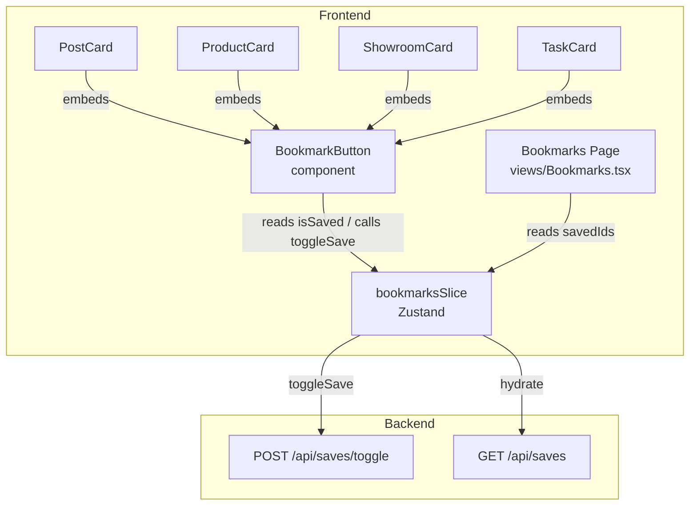

# Design Document — bookmark-and-business-separator

## Overview

This feature delivers three coordinated UI/UX enhancements to the Empire X platform:

1. **Business Name Pipe Separator** — a `|` delimiter rendered between consecutive business entries in the `PostCard` header (and profile header), styled with `text-muted-foreground`, capped at `slice(0, 2)`.
2. **Bookmark Toggle with Amber Active State** — a unified `BookmarkButton` component that shows `fill-amber-500 text-amber-500` when saved and `text-muted-foreground` with no fill when unsaved, with optimistic UI, in-flight disabling, and rollback + error toast on failure. Applied to Posts, Products, Showrooms, and Tasks.
3. **Global Bookmarks Store + Real-time Bookmarks Page** — a new Zustand slice (`bookmarksSlice`) that is the single source of truth for all saved item IDs; the Bookmarks page reads exclusively from it so any toggle anywhere in the app is reflected immediately.

The backend already exposes `POST /api/saves/toggle` and `GET /api/saves`, so no backend changes are required.

---

## Architecture



**Key architectural decisions:**

- `bookmarksSlice` is added to the existing `useAppStore` composite store (same pattern as `cartSlice`, `feedSlice`). It is NOT persisted to `sessionStorage` because bookmark state should be fresh-loaded on each session.
- The `BookmarkButton` is a single shared component (`components/ui/BookmarkButton.tsx`) that accepts `targetId`, `targetType`, and optional `itemData` props. This eliminates per-entity duplication of the bookmark logic.
- The `Bookmarks` view (`views/Bookmarks.tsx`) is refactored to drop its local `saves` and `enriched` state and read directly from `bookmarksSlice.savedIds`. This is what enables real-time updates.
- The business separator is a local presentational change inside `PostCard` — no new component needed, just a `<span>` interspersed between business `<Link>` elements.

---

## Components and Interfaces

### 1. `BookmarkButton` (`components/ui/BookmarkButton.tsx`)

A fully-controlled, accessible bookmark toggle button.

```typescript
interface BookmarkButtonProps {
  targetId: string;
  targetType: 'post' | 'product' | 'showroom' | 'task';
  /** Metadata stored in the store for Bookmarks page rendering */
  itemData?: {
    title?: string;
    thumbnailUrl?: string;
  };
  /** Optional CSS class override for the wrapping button */
  className?: string;
}
```

Rendered output:
- Uses Lucide `Bookmark` icon.
- Active state classes: `fill-amber-500 text-amber-500`
- Inactive state classes: `text-muted-foreground` (no fill)
- Disabled (in-flight): `opacity-50 cursor-not-allowed pointer-events-none`
- Focus ring: `focus-visible:outline-none focus-visible:ring-2 focus-visible:ring-amber-500/50`
- `aria-label`: dynamic — `"Bookmark this {targetType}"` when inactive, `"Remove bookmark"` when active
- `aria-pressed`: mirrors the current saved state

### 2. `bookmarksSlice` (`store/bookmarksSlice.ts`)

```typescript
export interface SavedItem {
  target_id: string;
  target_type: 'post' | 'product' | 'showroom' | 'task';
  title?: string;
  thumbnailUrl?: string;
}

export interface BookmarksSlice {
  savedIds: Record<string, SavedItem>;   // keyed by target_id
  isHydrating: boolean;
  error: string | null;

  // Selector
  isSaved: (targetId: string) => boolean;

  // Actions
  hydrate: () => Promise<void>;
  toggleSave: (
    targetId: string,
    targetType: SavedItem['target_type'],
    itemData?: Pick<SavedItem, 'title' | 'thumbnailUrl'>
  ) => Promise<void>;
}
```

`isSaved` is implemented as a method on the slice (consistent with Zustand's `get` pattern):

```typescript
isSaved: (targetId) => !!get().savedIds[targetId],
```

### 3. `PostCard` header — Business Separator

In the existing `PostCard` business row (`authorBusinesses.slice(0, 2).map(...)`), insert a `<span>` separator between entries:

```tsx
{authorBusinesses.slice(0, 2).map((b, idx) => (
  <React.Fragment key={b.id}>
    {idx > 0 && (
      <span className="text-muted-foreground text-[10px] select-none" aria-hidden="true">|</span>
    )}
    <Link href={...} className="...">
      <Store className="w-2.5 h-2.5 text-primary" />
      {b.business_name}
    </Link>
  </React.Fragment>
))}
```

The separator uses `aria-hidden="true"` because it is purely decorative.

### 4. Updated `store/index.ts`

Extend `AppStore` to include `BookmarksSlice`, spread `createBookmarksSlice` in the `create()` call, and exclude `savedIds` from `partialize` (not persisted).

### 5. Updated `views/Bookmarks.tsx`

Replace the local `saves` / `enriched` / `loading` state with:

```typescript
const savedIds = useAppStore(s => s.savedIds);
const hydrate  = useAppStore(s => s.hydrate);
const isSaved  = useAppStore(s => s.isSaved);
```

On mount, call `hydrate()` only if `Object.keys(savedIds).length === 0`. Tab filtering becomes a pure in-memory `Object.values(savedIds).filter(...)`. No additional `client.get('/api/saves')` call inside the view.

---

## Data Models

### API — `GET /api/saves` response

```typescript
// Array of save records returned by the existing backend endpoint
interface SaveRecord {
  id: string;
  user_id: string;
  target_id: string;
  target_type: 'post' | 'product' | 'showroom' | 'task';
  created_at: string;
}
```

The backend does not currently return `title` or `thumbnailUrl` in the saves table. The `bookmarksSlice` stores these fields from the `itemData` argument passed at toggle time (i.e., the calling card component knows its own title/thumbnail). On `hydrate()`, entries in `savedIds` will have `title: undefined` and `thumbnailUrl: undefined` unless already set by a previous toggle in the session — the Bookmarks page falls back to rendering what's available.

### `savedIds` map shape

```typescript
// store state
savedIds: {
  "abc123": { target_id: "abc123", target_type: "post", title: "...", thumbnailUrl: "..." },
  "def456": { target_id: "def456", target_type: "product", title: "...", thumbnailUrl: "..." },
}
```

### `toggleSave` optimistic update flow

```
1. snapshot = get().savedIds
2. if snapshot[targetId] exists → delete it (optimistic unsave)
   else → add it (optimistic save)
3. set({ savedIds: newMap })
4. await POST /api/saves/toggle { target_id, target_type }
5. if API returns { saved: true/false } that differs from optimistic state → correct it
6. on error → set({ savedIds: snapshot, error: message })
   → toast.error(...)
```

---

## Correctness Properties

*A property is a characteristic or behavior that should hold true across all valid executions of a system — essentially, a formal statement about what the system should do. Properties serve as the bridge between human-readable specifications and machine-verifiable correctness guarantees.*

### Property 1: Separator count invariant

*For any* array of businesses of length N ≥ 2, the PostCard header SHALL render exactly `min(N, 2) - 1` separator elements (i.e., exactly 1 separator) between the business entries.

**Validates: Requirements 1.2, 1.5**

---

### Property 2: Separator styling invariant

*For any* PostCard header rendering with 2 or more businesses, every rendered Business_Separator element SHALL have the `text-muted-foreground` CSS class.

**Validates: Requirements 1.3**

---

### Property 3: Business entry cap invariant

*For any* array of businesses of arbitrary length, the PostCard header SHALL render at most 2 business name entries.

**Validates: Requirements 1.5**

---

### Property 4: isSaved reflects savedIds

*For any* `savedIds` map in the Bookmarks_Store, `isSaved(targetId)` SHALL return `true` if and only if `targetId` is a key in `savedIds`.

**Validates: Requirements 6.1**

---

### Property 5: Hydrate populates savedIds from API response

*For any* array of save records returned by a mocked `GET /api/saves`, after calling `hydrate()`, the store's `savedIds` map SHALL contain exactly one entry per record, keyed by `target_id`, and `isSaved(target_id)` SHALL return `true` for each record in the response.

**Validates: Requirements 6.2**

---

### Property 6: Toggle round-trip restores original state

*For any* initial `savedIds` state and any `targetId`, calling `toggleSave(targetId, ...)` twice in sequence (with a successful API mock each time) SHALL result in `savedIds` being equivalent to the initial state.

**Validates: Requirements 2.2, 2.3, 3.2, 3.3, 4.2, 4.3, 5.2, 6.3**

---

### Property 7: Optimistic update is immediate

*For any* `savedIds` state and any `targetId`, after `toggleSave(targetId, ...)` is called but before the API call resolves, `isSaved(targetId)` SHALL return the opposite of its pre-call value.

**Validates: Requirements 2.2, 2.3, 3.2, 3.3, 4.2, 4.3, 5.2, 6.3**

---

### Property 8: Rollback on API failure

*For any* `savedIds` state and any `targetId`, if the API call within `toggleSave` throws an error, the store's `savedIds` SHALL revert to the pre-call state and `error` SHALL be set to a non-null string.

**Validates: Requirements 2.5, 3.4, 4.4, 5.3, 6.4**

---

### Property 9: Hydrate failure preserves savedIds

*For any* pre-existing `savedIds` state, if `hydrate()`'s `GET /api/saves` call fails, `savedIds` SHALL remain unchanged and `error` SHALL be set to a non-null string.

**Validates: Requirements 6.6**

---

### Property 10: BookmarkButton aria-pressed mirrors saved state

*For any* `savedIds` map and any `targetId`, the `BookmarkButton` rendered for that `targetId` SHALL have `aria-pressed` equal to `isSaved(targetId)` (true when saved, false when not saved).

**Validates: Requirements 8.3**

---

### Property 11: BookmarkButton aria-label reflects direction of action

*For any* `targetId` and `savedIds` state, the `BookmarkButton` SHALL render with an `aria-label` that describes adding the bookmark when `isSaved(targetId)` is `false`, and describes removing the bookmark when `isSaved(targetId)` is `true`.

**Validates: Requirements 8.1, 8.2**

---

### Property 12: Bookmarks page list matches store filtered by tab

*For any* `savedIds` map and any selected tab value, the Bookmarks page SHALL render exactly the items whose `target_type` matches the tab (or all items when tab is `"all"`), with no items appearing that are absent from `savedIds`.

**Validates: Requirements 7.1, 7.2, 7.5**

---

## Error Handling

| Failure scenario | Store behavior | UI behavior |
|---|---|---|
| `toggleSave` API call fails (network / 5xx) | Revert `savedIds` to pre-call snapshot; set `error` field | `toast.error("Failed to update bookmark")` via Sonner; button reverts to prior visual state |
| `toggleSave` called while another toggle in-flight for same `targetId` | Button is disabled (`aria-disabled`); call is blocked | No duplicate request; button shows disabled styling |
| `hydrate()` API call fails | `savedIds` unchanged; set `error` field | Bookmarks page shows empty state with retry option |
| `hydrate()` response is empty array | `savedIds` set to `{}` | Bookmarks page shows "no bookmarks" empty state |
| `GET /api/saves` returns item types not in known set | Filtered out silently | Only known `target_type` values rendered |

**In-flight guard:** Each `BookmarkButton` tracks a local `isPending` boolean via `useState`. While `isPending` is true the button element carries `disabled` and renders reduced opacity. This is a local concern — the store does not track per-item loading state.

**Error toast:** Uses the existing `sonner` (`toast`) library already used in `Bookmarks.tsx` and other components.

---

## Testing Strategy

### Tools

- **Unit / property tests**: Vitest + `@testing-library/react` + `@testing-library/user-event` + `fast-check` (all already in `devDependencies`)
- **Mocking**: Vitest's `vi.mock` / `vi.fn()` for `client` (axios) and for `sonner`'s `toast`

### Dual Testing Approach

**Unit / example tests** cover:
- PostCard header with zero, one, and two businesses (edge cases for the separator)
- `BookmarkButton` in-flight disabled state
- `BookmarkButton` keyboard activation (Enter/Space triggers toggle)
- Bookmarks page mounts with empty store → calls `hydrate()` once
- Bookmarks page mounts with pre-hydrated store → no spinner, no additional API call

**Property-based tests** cover Properties 1–12 above. Each test runs a minimum of 100 iterations via `fast-check`'s `fc.assert(fc.property(...))`.

### Property Test Configuration

```typescript
// Example: Property 6 — Toggle round-trip
// Feature: bookmark-and-business-separator, Property 6: Toggle round-trip restores original state
fc.assert(
  fc.property(
    fc.record({ targetId: fc.string({ minLength: 1 }), targetType: fc.constantFrom('post', 'product', 'showroom', 'task') }),
    async ({ targetId, targetType }) => {
      // ... set up store, mock API, call toggleSave twice, assert state equals initial
    }
  ),
  { numRuns: 100 }
);
```

Tag format applied to every property test:
```
// Feature: bookmark-and-business-separator, Property {N}: {property_title}
```

### Test File Layout

```
frontend-next/
  test/
    bookmarks/
      bookmarksSlice.property.test.ts    # Properties 4–9
      BookmarkButton.property.test.tsx   # Properties 7, 8, 10, 11
      BookmarksPage.property.test.tsx    # Property 12
    feed/
      PostCardHeader.property.test.tsx   # Properties 1–3
      PostCardHeader.unit.test.tsx       # Zero/one business edge cases
```

### Coverage Goals

- All 12 correctness properties implemented as property-based tests
- Example tests cover the 5 non-property acceptance criteria (2.4, 6.5, 7.4, 8.4, 8.5)
- Edge cases (1.4, zero businesses) covered in unit tests
