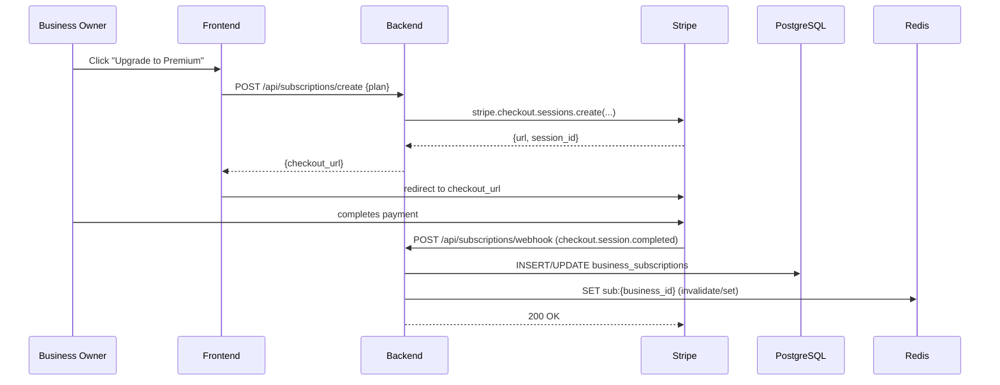

# Design: Business Subscription Tiers

## Overview

This feature adds a monetization layer to the Nodbusiness platform by introducing three business subscription tiers — **freemium**, **premium**, and **pro** — each unlocking progressively richer capabilities for business owners. The implementation touches the database, backend routing, background job queues, real-time Socket.IO rooms, and the Next.js frontend.

Stripe is used for subscription billing (already integrated). Tier enforcement is handled server-side by a `checkTierLimit()` middleware that reads from a Redis-cached `business_subscriptions` table, keeping hot paths free of DB round-trips. BullMQ handles asynchronous webhook delivery and usage recalculation.

### Tier Capability Summary

| Capability | freemium | premium | pro |
|---|---|---|---|
| Builder sections (existing freemium set) | ✓ | ✓ | ✓ |
| Builder sections (premium set) | — | ✓ | ✓ |
| Builder sections (pro set) | — | — | ✓ |
| Inventory catalog (bulk import) | — | ✓ | ✓ |
| Live location tracking | — | — | ✓ |
| Business webhooks | — | ✓ | ✓ |
| Business API keys | — | ✓ | ✓ |
| Analytics dashboard | — | ✓ | ✓ |

---

## Architecture

```mermaid
graph TD
  subgraph Frontend [Next.js App Router]
    A[SubscriptionManagementPage] --> B[Stripe Checkout redirect]
    C[TierGatedSection] --> D[UpgradePromptModal]
    E[BusinessInventoryDashboard]
    F[LiveLocationSection]
  end

  subgraph Backend [Express + TypeScript]
    G[POST /api/subscriptions/create] --> H[Stripe Checkout Session]
    I[POST /api/subscriptions/webhook] --> J[handleSubscriptionEvent]
    K[checkTierLimit middleware]
    L[POST /api/locations/update] --> M[Socket.IO broadcast]
    N[/api/business-webhooks/*]
    O[/api/business-api-keys/*]
    P[POST /api/products/bulk-import]
  end

  subgraph Queue [BullMQ]
    Q[webhookDeliveryQueue]
    R[usageRecalcQueue]
  end

  subgraph Storage
    S[(PostgreSQL)]
    T[(Redis / Upstash)]
  end

  B --> G
  J --> S
  J --> T
  K --> T
  Q --> N
  S --> T
```

### Stripe Subscription Flow



---

## Components and Interfaces

### Backend Route Modules

#### `/api/subscriptions/*`

| Method | Path | Auth | Description |
|---|---|---|---|
| GET | `/api/subscriptions/plans` | public | Returns available plan definitions |
| GET | `/api/subscriptions/my` | requireAuth | Returns caller's active subscription |
| POST | `/api/subscriptions/create` | requireAuth | Creates Stripe Checkout session |
| POST | `/api/subscriptions/cancel` | requireAuth | Schedules subscription cancellation |
| POST | `/api/subscriptions/webhook` | raw body | Handles Stripe subscription webhooks |

#### `/api/locations/update`

| Method | Path | Auth | Description |
|---|---|---|---|
| POST | `/api/locations/update` | requireAuth + checkTierLimit('live_location_tracking') | Upserts `live_locations` row and broadcasts to Socket.IO room |

#### `/api/business-webhooks/*`

| Method | Path | Auth | Description |
|---|---|---|---|
| GET | `/api/business-webhooks` | requireAuth + checkTierLimit('webhooks') | List webhooks for business |
| POST | `/api/business-webhooks` | requireAuth + checkTierLimit('webhooks') | Create endpoint |
| PUT | `/api/business-webhooks/:id` | requireAuth | Update endpoint |
| DELETE | `/api/business-webhooks/:id` | requireAuth | Delete endpoint |

#### `/api/business-api-keys/*`

| Method | Path | Auth | Description |
|---|---|---|---|
| GET | `/api/business-api-keys` | requireAuth + checkTierLimit('api_keys') | List keys (masked) |
| POST | `/api/business-api-keys` | requireAuth + checkTierLimit('api_keys') | Create key (returns plaintext once) |
| DELETE | `/api/business-api-keys/:id` | requireAuth | Revoke key |

#### `/api/products/bulk-import`

| Method | Path | Auth | Description |
|---|---|---|---|
| POST | `/api/products/bulk-import` | requireAuth + checkTierLimit('bulk_import') | Import products from JSON/CSV rows |

### Tier Enforcement Middleware

```typescript
// middleware/tierLimit.ts
export function checkTierLimit(feature: TierFeature): RequestHandler
```

`TierFeature` is a string literal union mapping features to minimum required tiers:

```typescript
type TierFeature =
  | 'bulk_import'          // premium+
  | 'live_location_tracking' // pro only
  | 'webhooks'             // premium+
  | 'api_keys'             // premium+
  | 'analytics'            // premium+
  | 'builder_premium'      // premium+
  | 'builder_pro';         // pro only

const FEATURE_MIN_TIER: Record<TierFeature, Tier[]> = {
  bulk_import:              ['premium', 'pro'],
  live_location_tracking:   ['pro'],
  webhooks:                 ['premium', 'pro'],
  api_keys:                 ['premium', 'pro'],
  analytics:                ['premium', 'pro'],
  builder_premium:          ['premium', 'pro'],
  builder_pro:              ['pro'],
};
```

The middleware:
1. Reads `business_id` from `req.user` (via the businesses table) or request params
2. Looks up `sub:{business_id}` in Redis (TTL 300s)
3. On cache miss: queries `business_subscriptions` and writes to Redis
4. Compares tier against `FEATURE_MIN_TIER[feature]`
5. On failure: returns `{ error: 'upgrade_required', currentTier, requiredTier, feature }` with HTTP 403

### `checkTierLimit` Cache Key Design

```
sub:{business_id}  →  JSON { tier, status, expires_at }  TTL 300s
```

### Socket.IO Live Location Room

Room naming: `business:{business_id}:tracking`

Events:
- `location_update` — emitted to the room when a business POSTs a new location
- `join_business_tracking` — client event to subscribe (server verifies pro tier)
- `leave_business_tracking` — client event to unsubscribe

### Frontend Components

| Component | Location | Purpose |
|---|---|---|
| `UpgradePromptModal` | `components/subscription/UpgradePromptModal.tsx` | Modal shown on 403 upgrade_required |
| `SubscriptionManagementPage` | `app/dashboard/subscription/page.tsx` | View/manage current plan, cancel |
| `BusinessInventoryDashboard` | `app/dashboard/inventory/page.tsx` | Product list + bulk import UI |
| `LiveLocationSection` | `components/showroom/LiveLocationSection.tsx` | Real-time map pin for pro showrooms |
| `TierGatedSection` | `components/subscription/TierGatedSection.tsx` | Wrapper that intercepts 403 and shows upgrade prompt |

---

## Data Models

### `business_subscriptions`

```sql
CREATE TABLE business_subscriptions (
  id                    UUID PRIMARY KEY DEFAULT gen_random_uuid(),
  business_id           UUID NOT NULL REFERENCES businesses(id) ON DELETE CASCADE,
  tier                  TEXT NOT NULL DEFAULT 'freemium'
                          CHECK (tier IN ('freemium','premium','pro')),
  status                TEXT NOT NULL DEFAULT 'active'
                          CHECK (status IN ('active','cancelled','past_due','trialing')),
  stripe_customer_id    TEXT,
  stripe_subscription_id TEXT,
  stripe_price_id       TEXT,
  current_period_start  TIMESTAMPTZ,
  current_period_end    TIMESTAMPTZ,
  cancel_at_period_end  BOOLEAN NOT NULL DEFAULT FALSE,
  created_at            TIMESTAMPTZ NOT NULL DEFAULT NOW(),
  updated_at            TIMESTAMPTZ NOT NULL DEFAULT NOW(),
  CONSTRAINT uq_business_subscription UNIQUE (business_id)
);

CREATE INDEX idx_bsub_stripe_sub ON business_subscriptions (stripe_subscription_id);
CREATE INDEX idx_bsub_business   ON business_subscriptions (business_id);
```

### `live_locations`

```sql
CREATE TABLE live_locations (
  id           UUID PRIMARY KEY DEFAULT gen_random_uuid(),
  business_id  UUID NOT NULL REFERENCES businesses(id) ON DELETE CASCADE,
  lat          NUMERIC(10,7) NOT NULL,
  lng          NUMERIC(10,7) NOT NULL,
  label        TEXT,
  accuracy_m   NUMERIC(8,2),
  updated_at   TIMESTAMPTZ NOT NULL DEFAULT NOW(),
  CONSTRAINT uq_live_location UNIQUE (business_id)
);

CREATE INDEX idx_live_locations_business ON live_locations (business_id);
```

### `business_webhooks`

```sql
CREATE TABLE business_webhooks (
  id           UUID PRIMARY KEY DEFAULT gen_random_uuid(),
  business_id  UUID NOT NULL REFERENCES businesses(id) ON DELETE CASCADE,
  url          TEXT NOT NULL,
  secret       TEXT NOT NULL,   -- used to generate HMAC-SHA256 signature
  events       TEXT[] NOT NULL DEFAULT '{}',  -- e.g. ['order.created','product.updated']
  is_enabled   BOOLEAN NOT NULL DEFAULT TRUE,
  created_at   TIMESTAMPTZ NOT NULL DEFAULT NOW(),
  updated_at   TIMESTAMPTZ NOT NULL DEFAULT NOW()
);

CREATE INDEX idx_bwebhooks_business ON business_webhooks (business_id);
```

### `business_api_keys`

```sql
CREATE TABLE business_api_keys (
  id           UUID PRIMARY KEY DEFAULT gen_random_uuid(),
  business_id  UUID NOT NULL REFERENCES businesses(id) ON DELETE CASCADE,
  name         TEXT NOT NULL,
  key_hash     TEXT NOT NULL UNIQUE,  -- SHA-256 of the raw key; plaintext never stored
  key_prefix   TEXT NOT NULL,         -- first 8 chars of raw key for display
  last_used_at TIMESTAMPTZ,
  is_active    BOOLEAN NOT NULL DEFAULT TRUE,
  created_at   TIMESTAMPTZ NOT NULL DEFAULT NOW()
);

CREATE INDEX idx_bapi_keys_business ON business_api_keys (business_id);
CREATE INDEX idx_bapi_keys_hash     ON business_api_keys (key_hash);
```

### `builderSections.ts` Extensions

Add two fields to `SectionType`:

```typescript
interface SectionType {
  key: string;
  label: string;
  icon: string;
  tier: 'freemium' | 'premium' | 'pro';
  tierLabel?: string;     // e.g. "Premium feature" — shown in locked state
  tierFeatures?: string[]; // bullet points shown in upgrade prompt
  fields: BuilderField[];
}
```

Add two new section types (both `tier: 'pro'`):

```typescript
{
  key: 'inventory_catalog',
  label: 'Inventory Catalog',
  icon: 'Package',
  tier: 'pro',
  tierLabel: 'Pro feature',
  tierFeatures: ['Live product sync', 'Bulk CSV/JSON import', 'Stock indicators'],
  fields: [
    { key: 'catalogTitle', label: 'Section Title', type: 'text', placeholder: 'Our Products' },
    { key: 'showStock',    label: 'Show stock levels', type: 'text', placeholder: 'true' },
  ],
},
{
  key: 'live_location_tracking',
  label: 'Live Location',
  icon: 'Navigation',
  tier: 'pro',
  tierLabel: 'Pro feature',
  tierFeatures: ['Real-time GPS pin on showroom', 'Visible to any visitor', 'Socket.IO powered'],
  fields: [
    { key: 'locationTitle', label: 'Section Title', type: 'text', placeholder: 'Find us live' },
  ],
},
```

### Migration File

The new tables above go into **`backend/db/migrate37.js`** following the established pattern.

### Stripe Plan Config

Plans are defined as server-side constants (not in DB) to avoid drift:

```typescript
// lib/subscriptionPlans.ts
export const PLANS = {
  premium_monthly: {
    tier: 'premium' as const,
    stripePriceId: process.env.STRIPE_PRICE_PREMIUM_MONTHLY!,
    interval: 'month',
    label: 'Premium',
    priceEtb: 299,
  },
  pro_monthly: {
    tier: 'pro' as const,
    stripePriceId: process.env.STRIPE_PRICE_PRO_MONTHLY!,
    interval: 'month',
    label: 'Pro',
    priceEtb: 799,
  },
} as const;

export type PlanKey = keyof typeof PLANS;
```

### BullMQ Job Types

```typescript
// Webhook delivery queue
interface WebhookDeliveryJobData {
  webhookId: string;
  businessId: string;
  event: string;
  payload: Record<string, unknown>;
  attemptNumber: number;
}

// Usage recalculation queue
interface UsageRecalcJobData {
  businessId: string;
  triggerEvent: 'subscription_activated' | 'subscription_cancelled' | 'tier_changed';
}
```

---

## Correctness Properties

*A property is a characteristic or behavior that should hold true across all valid executions of a system — essentially, a formal statement about what the system should do. Properties serve as the bridge between human-readable specifications and machine-verifiable correctness guarantees.*

### Property 1: Subscription tier round-trip

*For any* plan key (`premium_monthly` or `pro_monthly`), writing a `business_subscriptions` row with that plan's tier and then reading it back should return the same tier value.

**Validates: Requirements 1.3**

### Property 2: Stripe webhook confirms tier

*For any* business and any paid plan, processing a synthetic `checkout.session.completed` webhook event with that plan's `stripe_price_id` in the metadata should result in `business_subscriptions.tier` being set to the corresponding tier.

**Validates: Requirements 1.2**

### Property 3: Tier enforcement — block and allow

*For any* business tier and any `TierFeature`, calling `checkTierLimit(feature)` should return HTTP 403 if the tier is below the feature's minimum required tier, and should call `next()` (pass through) if the tier meets or exceeds the requirement. This property covers both blocking and allowing in a single parameterized sweep.

**Validates: Requirements 2.1, 2.2, 2.4**

### Property 4: Cancellation reverts tier at period end

*For any* active subscription, calling the cancel endpoint should set `cancel_at_period_end = true` and leave `tier` unchanged until `current_period_end`, after which the tier should become `freemium`.

**Validates: Requirements 1.4**

### Property 5: Live location broadcast reaches room

*For any* business with a `pro` subscription, posting a location update should result in a Socket.IO emission to the room `business:{business_id}:tracking`. Non-pro businesses should not trigger a broadcast.

**Validates: Requirements 3.1, 3.2**

### Property 6: Webhook HMAC sign/verify round-trip

*For any* payload and webhook secret, signing the payload with HMAC-SHA256 and then verifying the signature with the same secret should always succeed. Verifying with a different secret should always fail.

**Validates: Requirements 4.3**

### Property 7: Webhook delivery to all enabled endpoints

*For any* business and event type, enqueuing a `WebhookDeliveryJob` should result in one HTTP POST attempt per enabled webhook endpoint registered for that event. Disabled endpoints should be skipped.

**Validates: Requirements 4.2**

### Property 8: Bulk import partial success

*For any* mixed batch of product rows (some valid, some invalid), calling the bulk import endpoint should create exactly the valid rows and return exactly one error entry per invalid row, leaving the created rows unaffected.

**Validates: Requirements 5.1**

### Property 9: API key hash storage

*For any* newly created API key, the plaintext value should be returned exactly once in the creation response and should never appear in the `business_api_keys` table. The stored `key_hash` should equal `SHA-256(plaintext)`.

**Validates: Requirements 6.1**

---

## Error Handling

### Stripe Webhook Errors

Following the existing `webhook_events` idempotency pattern from `routes/orders.ts`:

1. Claim the event id with `INSERT ... ON CONFLICT DO NOTHING`
2. If no row inserted → duplicate delivery, return `{ received: true, duplicate: true }`
3. On handler failure → delete the claim row so Stripe re-delivers
4. Stripe subscription webhook handler lives in `routes/subscriptions.ts`, separated from the order webhook

### Tier Enforcement Error Response

All `checkTierLimit` failures return a structured 403:

```json
{
  "error": "upgrade_required",
  "currentTier": "freemium",
  "requiredTier": "premium",
  "feature": "bulk_import"
}
```

Frontend components inspect `error === 'upgrade_required'` and render `UpgradePromptModal`.

### Webhook Delivery Failures

`webhookDeliveryQueue` job config:
- `attempts: 5`
- `backoff: { type: 'exponential', delay: 5000 }` (5s, 10s, 20s, 40s, 80s)
- On final failure: update `business_webhooks.last_failure_at` and log via telemetry

### API Key Not Found

Authentication via API key returns `401 Unauthorized` with body `{ error: 'Invalid API key' }`. No detail is revealed about whether the key exists or is inactive.

### Location Update Without Pro Tier

Returns the standard `checkTierLimit` 403 response. The Socket.IO room join event (`join_business_tracking`) also verifies tier server-side before allowing the socket to join.

---

## Testing Strategy

### Unit Tests

Focus on specific examples, edge cases, and error conditions:

- `checkTierLimit` returns correct HTTP status for each tier/feature boundary (example tests for each combination at the boundary)
- Stripe plan constant maps price IDs to correct tier values
- HMAC signing produces deterministic output for a fixed key and payload
- Bulk import row validation catches missing `title`, negative `price`, invalid `currency`
- API key generation produces a 32-byte hex string and the stored hash matches

### Property-Based Tests

Use [fast-check](https://github.com/dubzzz/fast-check) (TypeScript-native, no additional runtime needed).

Configure each test with minimum 100 runs: `fc.assert(..., { numRuns: 100 })`.

Each test is tagged with a comment referencing the design property:
```
// Feature: business-subscription-tiers, Property N: <property text>
```

**Property 1 — Subscription tier round-trip**
Generator: `fc.constantFrom('premium_monthly', 'pro_monthly')` as plan key.
Assertion: after writing and re-reading, `tier` field equals `PLANS[plan].tier`.

**Property 2 — Stripe webhook confirms tier**
Generator: `fc.constantFrom('premium_monthly', 'pro_monthly')` combined with `fc.uuid()` as business_id.
Assertion: after calling the internal `handleSubscriptionEvent` with a synthetic `checkout.session.completed`, query confirms the expected tier.

**Property 3 — Tier enforcement block and allow**
Generator: `fc.record({ tier: fc.constantFrom('freemium','premium','pro'), feature: fc.constantFrom(...TierFeature values) })`.
Assertion: `checkTierLimit` result matches `FEATURE_MIN_TIER[feature].includes(tier)`.

**Property 4 — Cancellation leaves tier until period end**
Generator: `fc.record({ tier: fc.constantFrom('premium','pro'), periodEndOffset: fc.integer({ min: 1, max: 365 }) })` (days in future).
Assertion: cancel call sets `cancel_at_period_end=true` and tier is unchanged before `current_period_end`.

**Property 5 — Live location broadcast reaches room**
Generator: `fc.record({ lat: fc.float({ min: -90, max: 90 }), lng: fc.float({ min: -180, max: 180 }) })`.
Assertion: for a pro business, `getIO().to('business:{id}:tracking')` emits `location_update` with the posted coordinates.

**Property 6 — HMAC sign/verify round-trip**
Generator: `fc.record({ payload: fc.string(), secret: fc.string({ minLength: 16 }) })`.
Assertion: `verifyWebhookSignature(sign(payload, secret), payload, secret) === true` and `verifyWebhookSignature(sign(payload, secret), payload, differentSecret) === false`.

**Property 7 — Webhook delivery to all enabled endpoints**
Generator: `fc.array(fc.record({ url: fc.webUrl(), enabled: fc.boolean(), matchesEvent: fc.boolean() }), { minLength: 1, maxLength: 10 })`.
Assertion: mock HTTP call count equals the number of webhooks where `is_enabled && events.includes(event)`.

**Property 8 — Bulk import partial success**
Generator: `fc.array(fc.record({ title: fc.option(fc.string({ minLength: 1 })), price: fc.option(fc.float({ min: -10, max: 10000 })) }), { minLength: 1, maxLength: 50 })`.
Assertion: created count equals valid-row count, error count equals invalid-row count, and the two sets are disjoint.

**Property 9 — API key hash storage**
Generator: `fc.string({ minLength: 10 })` as business_id.
Assertion: the `key_hash` in DB equals `crypto.createHash('sha256').update(plaintext).digest('hex')` and the `key_hash` column does not contain the plaintext.
