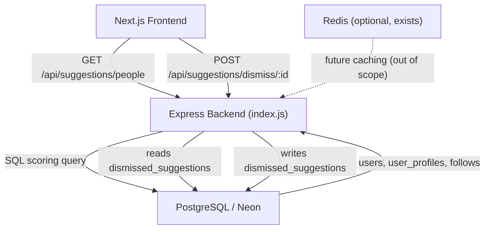

# Design Document: Friend Suggestions & AI-User Distinction

## Overview

This document describes the technical design for two interconnected features in Nodbusiness:

1. **AI-User Distinction** — a data-model flag (`is_seed`) that permanently marks demo/seed accounts, exposed through every API surface and rendered as a "Demo" badge in the UI.
2. **Friend Suggestion System** — a scored, ranked API that surfaces up to 20 users a requester may want to follow, computed from mutual connections, shared location, and activity recency, with a dismiss mechanism and a frontend widget.

The stack is Node.js/Express (backend) + PostgreSQL/Neon (database) + Next.js 16 / TypeScript (frontend). Both features share the same migration and are wired together at the scoring and rendering layer.

---

## Architecture



The backend adds a single new route file (`routes/suggestions.js`) and a single migration file (`db/migrate12.js`). The frontend adds:
- `api/suggestions.ts` — typed API module
- `components/suggestions/PeopleYouMayKnow.tsx` — the sidebar widget
- `components/suggestions/SuggestionCard.tsx` — individual suggestion card
- `components/profile/DemoBadge.tsx` — reusable demo badge

---

## Components and Interfaces

### Backend

#### `db/migrate12.js` — Database migration

Performs three non-destructive operations in a single transaction:
1. Adds `is_seed BOOLEAN NOT NULL DEFAULT FALSE` to `users`.
2. Backfills `is_seed = TRUE` for all existing `@nodbusiness.test` emails.
3. Creates the `dismissed_suggestions` table.

#### `routes/suggestions.js`

| Method | Path | Auth | Description |
|--------|------|------|-------------|
| `GET` | `/api/suggestions/people` | Required | Returns up to 20 scored suggestions |
| `POST` | `/api/suggestions/dismiss/:targetUserId` | Required | Dismisses a suggestion |

#### Suggestion scoring function

Pure JavaScript function `computeScore(candidate, requester)` — accepts plain objects, returns a numeric score. Extracted from the route handler to be unit-testable independently of the database.

```
computeScore(candidate, requester) → number
```

Parameters:
- `candidate.mutual_count` — number of shared follows
- `candidate.location` — text location string
- `requester.location` — text location string
- `candidate.last_active_at` — ISO timestamp

Scoring formula (from Requirement 5.1):
```
score = min(mutual_count * 5, 50)
      + (candidate.location === requester.location ? 10 : 0)
      + (daysSince(last_active_at) <= 30 ? 5 : 0)
```

#### Modified endpoints that gain `is_seed`

| File | Change |
|------|--------|
| `routes/auth.js` — `GET /api/auth/me` | Add `is_seed` to SELECT |
| `routes/profiles.js` — all profile reads | JOIN `users` to include `is_seed` |
| `routes/search.js` — user search results | JOIN `users` to include `is_seed` |
| `db/seed.js` — user INSERT | Pass `is_seed = TRUE` |
| `routes/auth.js` — `POST /api/auth/register` | Explicit `is_seed = FALSE` in INSERT |

### Frontend

#### `api/suggestions.ts`

```typescript
export interface Suggestion {
  user_id: string;
  display_name: string;
  avatar_url: string | null;
  headline: string | null;
  location: string | null;
  follower_count: number;
  mutual_count: number;
  is_seed: boolean;
}

export const suggestionsApi = {
  getPeople(): Promise<Suggestion[]>;
  dismiss(targetUserId: string): Promise<void>;
};
```

#### `components/suggestions/PeopleYouMayKnow.tsx`

React component using TanStack Query (`useQuery`) to fetch suggestions. Renders up to 5 cards in the right panel of `AppLayout`. Handles follow and dismiss actions with optimistic updates.

#### `components/profile/DemoBadge.tsx`

```tsx
<DemoBadge />  // renders: <span aria-label="AI-generated demo account" …>Demo</span>
```

Used wherever a user name/avatar is rendered when `is_seed === true`.

---

## Data Models

### `users` table — new column

```sql
ALTER TABLE users
  ADD COLUMN IF NOT EXISTS is_seed BOOLEAN NOT NULL DEFAULT FALSE;
```

All existing rows default to `FALSE`. The seed script backfill sets `TRUE` for `@nodbusiness.test` accounts.

### `dismissed_suggestions` table — new table

```sql
CREATE TABLE IF NOT EXISTS dismissed_suggestions (
  id           UUID PRIMARY KEY DEFAULT gen_random_uuid(),
  requester_id UUID NOT NULL REFERENCES users(id) ON DELETE CASCADE,
  target_id    UUID NOT NULL REFERENCES users(id) ON DELETE CASCADE,
  created_at   TIMESTAMPTZ NOT NULL DEFAULT NOW(),
  UNIQUE(requester_id, target_id)
);
CREATE INDEX IF NOT EXISTS idx_dismissed_suggestions_requester
  ON dismissed_suggestions(requester_id);
```

### Suggestion query (annotated SQL)

```sql
WITH requester AS (
  SELECT u.id, up.location, u.is_seed
  FROM users u
  JOIN user_profiles up ON up.user_id = u.id
  WHERE u.id = $1
),
mutual AS (
  -- Count mutual follows: people the requester follows who also follow candidate
  SELECT f2.follower_id AS candidate_id, COUNT(*) AS mutual_count
  FROM follows f1
  JOIN follows f2 ON f1.followed_id = f2.followed_id
  WHERE f1.follower_id = (SELECT id FROM requester)
    AND f2.follower_id <> (SELECT id FROM requester)
  GROUP BY f2.follower_id
),
candidates AS (
  SELECT
    u.id                   AS user_id,
    up.display_name,
    up.avatar_url,
    up.headline,
    up.location,
    up.follower_count,
    u.is_seed,
    u.updated_at           AS last_active_at,
    COALESCE(m.mutual_count, 0) AS mutual_count,
    -- Score computation
    LEAST(COALESCE(m.mutual_count, 0) * 5, 50)
      + CASE WHEN up.location = (SELECT location FROM requester) THEN 10 ELSE 0 END
      + CASE WHEN u.updated_at >= NOW() - INTERVAL '30 days' THEN 5 ELSE 0 END
    AS suggestion_score
  FROM users u
  JOIN user_profiles up ON up.user_id = u.id
  LEFT JOIN mutual m ON m.candidate_id = u.id
  WHERE u.id <> $1                                         -- exclude requester
    AND u.id NOT IN (                                      -- exclude already-followed
      SELECT followed_id FROM follows WHERE follower_id = $1
    )
    AND u.id NOT IN (                                      -- exclude dismissed
      SELECT target_id FROM dismissed_suggestions WHERE requester_id = $1
    )
)
SELECT *
FROM candidates
ORDER BY
  suggestion_score DESC,
  follower_count DESC,           -- tiebreaker 1: follower count
  is_seed ASC,                   -- tiebreaker 2: real users above seed (FALSE < TRUE)
  user_id                        -- tiebreaker 3: stable ordering
LIMIT 20;
```

**Fallback** (Requirement 4.5): When fewer than 20 candidates are returned by the scored query, the backend supplements with recently joined `Real_Users` not already in the result set, until the total reaches 20 or there are no more candidates.

---

## Correctness Properties

*A property is a characteristic or behavior that should hold true across all valid executions of a system — essentially, a formal statement about what the system should do. Properties serve as the bridge between human-readable specifications and machine-verifiable correctness guarantees.*

### Property 1: Scored candidates are always excluded from the requester and already-followed users

*For any* requester and any set of users, every user returned by the suggestion engine should have an id that is neither the requester's id nor the id of any user the requester already follows.

**Validates: Requirements 4.2, 4.3**

---

### Property 2: Dismissed users never appear in subsequent suggestions

*For any* requester and any target user that has been dismissed, the suggestion engine should never include that target in its results.

**Validates: Requirements 4.4, 6.2**

---

### Property 3: Suggestion count is bounded by 20

*For any* requester, the list returned by the suggestion engine contains at most 20 items.

**Validates: Requirements 4.1**

---

### Property 4: Scoring formula preserves ordering

*For any* pair of candidates A and B where `computeScore(A, requester) > computeScore(B, requester)`, candidate A should appear before candidate B in the sorted result list.

**Validates: Requirements 4.7, 5.1, 5.2**

---

### Property 5: Score is always non-negative and bounded

*For any* candidate and requester pair, `computeScore(candidate, requester)` returns a value in the range `[0, 65]` (50 mutual cap + 10 location + 5 activity).

**Validates: Requirements 5.1**

---

### Property 6: Idempotent dismiss

*For any* requester who calls dismiss on the same target user twice, the second call returns HTTP 200 and the dismissed_suggestions table contains exactly one row for that pair.

**Validates: Requirements 6.3**

---

### Property 7: is_seed flag survives round-trip through the API

*For any* user record with a given `is_seed` value, the value returned by the `/api/auth/me` and profile endpoints must equal the value stored in the database.

**Validates: Requirements 1.5, 2.1, 2.2**

---

## Error Handling

| Scenario | Behaviour |
|----------|-----------|
| Requester has no profile / no follows | Returns up to 20 recently-joined Real_Users as fallback |
| Fewer than 20 scored candidates | Supplemented with recently-joined Real_Users |
| Dismiss self (`targetUserId === req.user.id`) | HTTP 400 `{ error: "Cannot dismiss yourself" }` |
| Profile not found on profile endpoint | HTTP 404 — no `is_seed` in response body |
| Suggestion API unreachable (frontend) | Non-blocking toast error; rest of page continues rendering |
| Database error in suggestion query | HTTP 500 with generic error message; error logged via `pino` |

---

## Testing Strategy

### Property-based testing library

**Backend**: `fast-check` (already in `devDependencies` — `"fast-check": "^3.23.2"`).
**Frontend**: `fast-check` (already in `devDependencies` — `"fast-check": "^4.9.0"`).

Each property-based test runs a minimum of **100 iterations**.

### Unit tests (backend — Jest)

Located in `backend/test/suggestions/`:
- `computeScore.test.js` — tests the pure scoring function with concrete examples and edge cases (zero mutuals, same location, activity boundary at exactly 30 days).
- `suggestions.route.test.js` — supertest integration tests for the route handler: authenticated/unauthenticated access, dismiss self, idempotent dismiss.

### Property-based tests (backend — Jest + fast-check)

Located in `backend/test/suggestions/`:

- **`suggestions.pbt.test.js`**

  | Tag | Property |
  |-----|----------|
  | `Feature: friend-suggestions, Property 1` | For any generated user set, no requester or followed user appears in results |
  | `Feature: friend-suggestions, Property 2` | For any generated dismissed set, dismissed users never appear |
  | `Feature: friend-suggestions, Property 3` | Result length ≤ 20 for any input |
  | `Feature: friend-suggestions, Property 4` | Sort order is consistent with score ordering |
  | `Feature: friend-suggestions, Property 5` | Score ∈ [0, 65] for any candidate/requester pair |
  | `Feature: friend-suggestions, Property 6` | Double dismiss yields one row, HTTP 200 both times |
  | `Feature: friend-suggestions, Property 7` | `is_seed` round-trip fidelity through API response |

All database interactions in property tests are mocked using an in-memory fake repository to keep cost low and iterations fast.

### Unit tests (frontend — Vitest)

Located in `frontend-next/test/`:
- `suggestions.test.tsx` — tests `PeopleYouMayKnow` renders correctly, shows "No more suggestions" on empty list, shows error message on API failure.
- `DemoBadge.test.tsx` — tests badge renders when `is_seed=true`, is absent when `is_seed=false`, has correct ARIA label.

### Integration tests (not property-based)

- **Migration smoke test**: Run `migrate12.js` against a test DB, verify `is_seed` column exists and all `@nodbusiness.test` rows are backfilled.
- **End-to-end follow/dismiss flow**: Single sequence — register two users, follow one, call suggestions, verify neither the followed user nor requester appear.
