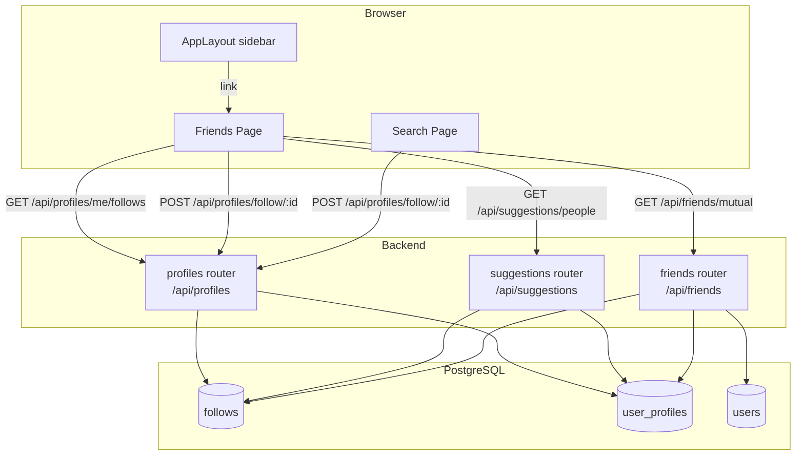

# Design Document — Friends Tab

## Overview

This feature adds two enhancements to Nodbusiness:

1. **Friends Tab** — a dedicated `/friends` page accessible from a new sidebar nav entry. The page has three sections (My Friends, Friend Suggestions, Mutual Friends), each showing up to 5 user cards in a collapsed state with a "More" button to expand inline.

2. **Collapsible Search Sections** — every section on the `/search` page collapses to 5 results by default. A labelled "Show N more" button expands a section inline; "Show less" collapses it again. State resets when the query or tab changes.

The backend already has `GET /api/suggestions/people`, `GET /api/profiles/me/follows`, and `POST /api/profiles/follow/:userId`. A new `GET /api/friends/mutual` endpoint is required.

---

## Architecture

### System-level data flow



### Key design decisions

| Decision | Rationale |
|---|---|
| New `backend/routes/friends.js` file | Keeps the new endpoint isolated from the general profiles router, matching the existing pattern (suggestions, profiles, etc. each in their own file). |
| `useCollapse` custom hook | The collapse/expand + reset logic is identical across three Friends sections and seven Search sections. A single hook eliminates duplication. |
| Extend `SuggestionCard` → new `UserCard` component | `SuggestionCard` handles the identical layout (avatar, name, headline, mutual count, follow button). `UserCard` adds an `isFollowing` prop so the button can render as "Unfollow" for already-followed users. |
| Optimistic UI for follow/unfollow | Requirement 7.2–7.4 demand immediate visual feedback. The pattern already used in `SuggestionCard` (`useState(false)`) is extended to include revert-on-error. |
| Single `followsSet` state on Friends page | Fetched once on mount, then mutated locally on each follow/unfollow action. Avoids re-fetching the full list after every interaction. |

---

## Components and Interfaces

### Backend

#### `backend/routes/friends.js` (new file)

```
GET /api/friends/mutual
  Auth: requireAuth
  Response 200: MutualFriend[]
  Response 401: { error: "Unauthorized" }
```

`MutualFriend` shape:
```
{
  user_id:      string (UUID)
  display_name: string
  avatar_url:   string | null
  headline:     string | null
  is_following: boolean
  mutual_count: number
}
```

#### `backend/index.js` (modification)

Add one line after the suggestions route registration:
```js
app.use('/api/friends', require('./routes/friends'));
```

---

### Frontend

#### `frontend-next/api/friends.ts` (new file)

```ts
interface MutualFriend {
  user_id: string;
  display_name: string;
  avatar_url: string | null;
  headline: string | null;
  is_following: boolean;
  mutual_count: number;
}

const friendsApi = {
  getMutual(): Promise<MutualFriend[]>
}
```

#### `frontend-next/hooks/useCollapse.ts` (new file)

```ts
// Input: total item count, threshold (default 5)
// Output: { visibleCount, isExpanded, expand, collapse }
function useCollapse(total: number, threshold?: number): CollapseState
```

Used by every collapsible section on the Friends page and in Search.

#### `frontend-next/components/friends/UserCard.tsx` (new file)

Extends the visual pattern of `SuggestionCard` with:
- `isFollowing: boolean` prop — renders "Unfollow" or "Follow"
- No dismiss (X) button (not needed outside suggestions sidebar)
- `onToggleFollow(userId: string, currentlyFollowing: boolean) => void` callback
- Optimistic UI: flip local state immediately, revert + toast on API error

Props interface:
```ts
interface UserCardProps {
  userId: string;
  displayName: string;
  avatarUrl: string | null;
  headline: string | null;
  mutualCount?: number;
  isFollowing: boolean;
  onToggleFollow: (userId: string, currentlyFollowing: boolean) => void;
}
```

#### `frontend-next/views/Friends.tsx` (new file)

Page view component containing three `<FriendsSection>` blocks:

```
<FriendsSection title="My Friends"         items={myFriends}    loading={loadingFollows} />
<FriendsSection title="Friend Suggestions" items={suggestions}  loading={loadingSugg}   />
<FriendsSection title="Mutual Friends"     items={mutuals}      loading={loadingMutual} />
```

Each `<FriendsSection>` uses `useCollapse` and renders `<UserCard>` per item.

State owned by `Friends.tsx`:
- `followsSet: Set<string>` — initialized from `GET /api/profiles/me/follows`; mutated on every follow/unfollow
- Data arrays for each of the three sections
- Loading booleans per section

#### `frontend-next/app/(app)/friends/page.tsx` (new file)

Thin Next.js route file:
```tsx
'use client';
export { default } from '@/views/Friends';
```

#### `frontend-next/components/layout/AppLayout.tsx` (modification)

Insert a Friends nav item into `mainNavItems` array, immediately after the Explore entry:

```ts
{ path: "/friends", icon: Users, label: "Friends" }
```

The same `NavLink` component used for all other entries renders the active state, icon-only collapsed mode, and tooltip automatically — no structural changes required.

Also insert the Friends link in the mobile drawer `<div>` that maps `mainNavItems`.

#### `frontend-next/views/Search.tsx` (modification)

1. Add `expandedSections` state: `Record<string, boolean>` keyed by section name.
2. Two `useEffect` hooks reset all section states: one on `debouncedQuery` change, one on `tab` change.
3. Replace the bare `<Section>` component with a `<CollapsibleSection>` variant that:
   - Accepts `items: T[]` and renders `items.slice(0, expanded ? items.length : 5)`
   - Shows a "Show {extra} more" button when `items.length > 5` and not expanded
   - Shows a "Show less" button when expanded
   - Calls `setExpandedSections` on click

---

## Data Models

### `follows` table (existing — no migration needed)

```
follower_id  uuid  FK → users.id
followed_id  uuid  FK → users.id
```

### `user_profiles` table (existing — relevant columns)

```
user_id      uuid
display_name text
avatar_url   text
headline     text
```

### `GET /api/friends/mutual` — SQL design

```sql
WITH
  -- Users who follow the current user back (mutual follow)
  follow_back AS (
    SELECT
      u.id              AS user_id,
      up.display_name,
      up.avatar_url,
      up.headline,
      TRUE              AS is_following,   -- current user already follows them
      0                 AS mutual_count
    FROM follows f_them_to_me
    JOIN follows f_me_to_them
      ON f_me_to_them.follower_id = $1
     AND f_me_to_them.followed_id = f_them_to_me.follower_id
    JOIN users u ON u.id = f_them_to_me.follower_id
    JOIN user_profiles up ON up.user_id = u.id
    WHERE f_them_to_me.followed_id = $1
      AND u.id <> $1
  ),
  -- Users sharing ≥1 common followed user with the current user
  shared_conn AS (
    SELECT
      f2.follower_id    AS user_id,
      COUNT(*)          AS mutual_count
    FROM follows f1
    JOIN follows f2
      ON f2.followed_id = f1.followed_id
     AND f2.follower_id <> $1
    WHERE f1.follower_id = $1
    GROUP BY f2.follower_id
  ),
  combined AS (
    SELECT
      u.id              AS user_id,
      up.display_name,
      up.avatar_url,
      up.headline,
      EXISTS(
        SELECT 1 FROM follows
        WHERE follower_id = $1 AND followed_id = u.id
      )                 AS is_following,
      COALESCE(sc.mutual_count, 0) AS mutual_count
    FROM shared_conn sc
    JOIN users u ON u.id = sc.user_id
    JOIN user_profiles up ON up.user_id = u.id
    WHERE u.id <> $1
    UNION
    SELECT * FROM follow_back
  )
SELECT DISTINCT ON (user_id)
  user_id, display_name, avatar_url, headline, is_following, mutual_count
FROM combined
ORDER BY user_id, mutual_count DESC
LIMIT 50
```

The outer `ORDER BY mutual_count DESC, display_name ASC` is applied after the DISTINCT de-duplication via a wrapping query.

---

## Correctness Properties

*A property is a characteristic or behavior that should hold true across all valid executions of a system — essentially, a formal statement about what the system should do. Properties serve as the bridge between human-readable specifications and machine-verifiable correctness guarantees.*

### Property 1: Collapse threshold invariant

*For any* list of N items rendered in a collapsible section (Friends or Search), the number of visible items should equal `min(N, 5)` in Collapsed_State, and a "More" button should appear if and only if `N > 5`.

**Validates: Requirements 2.3, 3.3, 4.4, 6.1, 6.2**

---

### Property 2: Expand/collapse toggle correctness

*For any* collapsible section currently in Collapsed_State with a "More" button, clicking "More" should transition the section to Expanded_State where all N items are visible and a "Show less" button is present; clicking "Show less" should return the section to Collapsed_State.

**Validates: Requirements 2.4, 3.4, 4.5, 6.4, 6.5**

---

### Property 3: Nav active state reflects pathname

*For any* application pathname, the Friends navigation link should be in the active/highlighted state if and only if the pathname is `/friends`.

**Validates: Requirements 1.2**

---

### Property 4: UserCard contains all required fields

*For any* user record (followed user, suggestion, or mutual friend), the rendered `UserCard` should contain: an avatar image or fallback initials element, the display name, the headline (when non-null), and a follow/unfollow button.

**Validates: Requirements 2.2, 3.2, 4.3**

---

### Property 5: Optimistic follow/unfollow with revert on failure

*For any* `UserCard`, clicking the follow/unfollow button should immediately flip the button's visual state before the API call resolves. If the API call fails, the button should revert to its pre-click state and an error toast should be displayed.

**Validates: Requirements 2.5, 3.5, 7.2, 7.3, 7.4**

---

### Property 6: Mutual friends SQL correctness

*For any* follows graph in the database, calling `GET /api/friends/mutual` as user A should return exactly the set of users B where:
- (A follows B AND B follows A), OR
- there exists at least one user C such that (A follows C AND B follows C).

**Validates: Requirements 4.2, 5.2**

---

### Property 7: Self-exclusion from mutual friends response

*For any* authenticated user calling `GET /api/friends/mutual`, their own `user_id` must not appear in the response array.

**Validates: Requirement 5.3**

---

### Property 8: Response shape completeness

*For any* record in the `GET /api/friends/mutual` response, all six fields (`user_id`, `display_name`, `avatar_url`, `headline`, `is_following`, `mutual_count`) must be present and non-undefined (though `avatar_url` and `headline` may be `null`).

**Validates: Requirement 5.4**

---

### Property 9: Mutual friends ordering invariant

*For any* response array of length ≥ 2 from `GET /api/friends/mutual`, for every pair of adjacent records `[i]` and `[i+1]`: `mutual_count[i] >= mutual_count[i+1]`, and when `mutual_count[i] === mutual_count[i+1]`, `display_name[i] <= display_name[i+1]` (case-insensitive).

**Validates: Requirement 5.5**

---

### Property 10: Result cap of 50

*For any* user with any number of followers and connections, `GET /api/friends/mutual` must return at most 50 records.

**Validates: Requirements 4.8, 5.6**

---

### Property 11: "Show more" button label accuracy

*For any* Search section with N results where N > 5, the "More" button label must display the text "Show {N - 5} more" (where N - 5 is the exact count of hidden results).

**Validates: Requirement 6.3**

---

### Property 12: Section state independence

*For any* combination of expanded/collapsed states across multiple Search sections, expanding or collapsing one section must not change the visible count or expanded state of any other section.

**Validates: Requirement 6.6**

---

### Property 13: Reset to collapsed on query or tab change

*For any* Search section that is currently in Expanded_State, after the search query value changes or the active tab changes, the section must transition back to Collapsed_State.

**Validates: Requirements 6.7, 6.8**

---

### Property 14: Follow button initialized from Follows API

*For any* set of followed user IDs returned by `GET /api/profiles/me/follows`, every `UserCard` on the Friends page whose `userId` is in that set should initially render an "Unfollow" button, and every card whose `userId` is not in that set should initially render a "Follow" button.

**Validates: Requirement 7.1**

---

### Property 15: Error vs empty-state mutual exclusion

*For any* API error response from `GET /api/suggestions/people`, the Friend Suggestions section must show an inline error message and must not show the "No new suggestions right now." empty-state message. Conversely, when the API returns a successful empty array, only the empty-state message should appear.

**Validates: Requirement 3.8**

---

## Error Handling

| Scenario | Handling |
|---|---|
| `GET /api/friends/mutual` returns 401 | AppLayout redirect to `/login` (existing `useEffect` in `AppLayout.tsx` handles auth check; API client returns 401 → AuthContext handles session expiry). |
| `GET /api/friends/mutual` returns 500 | Inline error banner in Mutual Friends section. Does not affect My Friends or Suggestions sections (each section has independent error state). |
| `GET /api/suggestions/people` error | Inline error message shown; empty-state message suppressed (Property 15). |
| `GET /api/profiles/me/follows` error | Toast + all `UserCard` follow buttons default to "Follow" state with a note that follow state may be inaccurate. |
| Follow/unfollow API call fails | Optimistic update reverted; `sonner` toast with message "Failed to update follow status" (Property 5). |
| Search section API already returns data; user expands; query changes | `useEffect` on `debouncedQuery` resets all `expandedSections` state to `{}` (Property 13). |

---

## Testing Strategy

### Unit / Component tests (Vitest + React Testing Library)

- **`useCollapse` hook**: Test collapse threshold (Property 1), expand/collapse toggle (Property 2), and reset behavior (Properties 13).
- **`UserCard` component**: Test required fields rendering (Property 4), optimistic follow/unfollow (Property 5), revert on failure (Property 5).
- **`Friends` page**: Test section loading skeletons, empty states, error vs empty-state exclusion (Property 15), follow button initialization (Property 14).
- **`AppLayout` nav**: Test Friends link active state for `/friends` vs other paths (Property 3), presence in both desktop sidebar and mobile drawer.
- **`Search` section collapse**: Test "Show N more" label (Property 11), section state independence (Property 12).

### Property-based tests (fast-check, minimum 100 runs each)

The property-based testing library is **fast-check** (already standard in the JS ecosystem; compatible with Vitest).

Each property test is tagged: `// Feature: friends-tab, Property {N}: {description}`

- **P1 — Collapse threshold**: Generate `fc.integer({ min: 0, max: 100 })` for item count; assert `visibleCount === Math.min(N, 5)` and `showMore === N > 5`.
- **P2 — Expand/collapse toggle**: Generate item count > 5; simulate click More → assert all visible; click Show less → assert back to 5.
- **P3 — Nav active state**: Generate `fc.webPath()` for pathname; assert `isActive("/friends") === (pathname === "/friends")`.
- **P4 — UserCard fields**: Generate arbitrary `UserCardProps`; assert rendered output contains all required elements.
- **P5 — Optimistic update**: Generate `fc.boolean()` for API success/fail; verify state flip on click, revert on failure.
- **P6 — Mutual friends SQL**: Unit-test the SQL logic using in-memory follows graph; generate `fc.array(fc.record({ a: fc.uuid(), b: fc.uuid() }))` for follows edges; verify result set matches expected union of conditions.
- **P7 — Self-exclusion**: Generate user ID + follows graph; assert own ID not in result.
- **P8 — Response shape**: Generate random rows from the mutual friends query; assert all six fields present.
- **P9 — Ordering invariant**: Generate result arrays and sort; assert `mutual_count DESC, display_name ASC` ordering.
- **P10 — Result cap**: Generate large follows graphs; assert `result.length <= 50`.
- **P11 — Label accuracy**: Generate `fc.integer({ min: 6, max: 20 })`; assert button label `=== \`Show ${N-5} more\``.
- **P12 — Section independence**: Generate section names and expanded states; toggle one; assert others unchanged.
- **P13 — Reset on change**: Generate arbitrary section states; simulate query/tab change; assert all collapsed.
- **P14 — Follow init**: Generate followed IDs set and user card list; assert button state matches set membership.
- **P15 — Error vs empty exclusion**: Property over `{ hasError: boolean, isEmpty: boolean }`; assert exactly one of (error UI, empty-state UI) renders based on `hasError`.

### Integration tests

- Backend: `GET /api/friends/mutual` with seeded DB — verify correct mutual friend set, ordering, 50-record cap, 401 on unauthenticated request.
- Backend: `POST /api/profiles/follow/:id` toggle — verify follow/unfollow persistence.

### Manual / smoke tests

- Auth guard: unauthenticated request to `/api/friends/mutual` returns 401.
- Friends tab visible in both desktop sidebar (expanded + collapsed) and mobile drawer.
